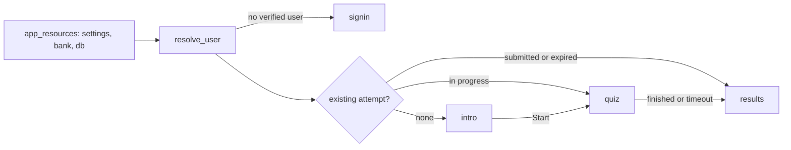

# Clanker Constitution

Ensure that you follow the Clanker Constitution instructions, available in the `CONSTITUTION.md` file at the root of this project repository.

# Application Overview

`rpharma2026.quiz` is a golem Shiny app for the R/Pharma 2026 conference. It
is a timed quiz with a leaderboard, deployed on the Ricochet platform. Each
signed-in user gets exactly one attempt: questions are drawn at random from a
JSON question bank, the whole quiz has one time limit, and submitted attempts
are ranked by score and then by duration.

## Runtime flow



- `app_resources()` (`R/app_server.R`) runs once per R process and caches
  settings, the validated bank, and the database pool for all sessions. It
  also creates the tables (idempotent). The pool closes on app stop.
- `app_server()` holds the shared `quiz_state` (`reactiveValues()` with
  `user`, `attempt`, `status`). `status` names the visible screen and drives
  `bslib::nav_select()` on the hidden navset `screen` in `app_ui()`
  (`loading`, `signin`, `intro`, `quiz`, `results`).
- `mod_quiz` shows one question at a time with Back/Next and a numbered
  navigator. It saves each answer as it is picked, and finalizes the attempt
  on submit or timeout, then sets `status` to `"results"`.
- `mod_results` scores the attempt and shows score, duration, rank, the
  leaderboard, and a per-question review with explanations.

## Key design decisions

- The server owns all state. Attempts, the drawn question order, the option
  order, and the answers live in the database, so a reload or reconnect
  resumes the same attempt with the same deadline.
- Timing: the deadline is stored as `deadline_at` (epoch seconds).
  `inst/app/www/timer.js` only shows the countdown and sends `time_up`. The
  server checks the deadline again (allowing `quiz_grace_seconds` slack). A
  `later::later()` backstop finalizes the attempt if the browser tab is
  throttled. `db_save_answer()` rejects writes after the deadline in SQL.
- Radio choice values are `"<question_id>::<value>"` (`encode_choice()`), so
  a stale input event can never be saved against the wrong question.
- Leaderboard order: `score DESC, duration_seconds ASC, submitted_at ASC`.

## Files

| File | Role |
|------|------|
| `R/app_ui.R`, `R/app_server.R` | Screens, shared state, process-wide resources |
| `R/mod_quiz.R` | Question display, navigation, answer saving, timer, submit |
| `R/mod_results.R` | Score, rank, leaderboard, answer review |
| `R/fct_quiz.R` | Pure logic: bank loading/validation, drawing, scoring, formatting |
| `R/fct_bank_storage.R` | Reads the bank from `inst/app/` or `s3://bucket/key` (Linode Object Storage) |
| `R/fct_db.R` | DB connection (SQLite or Postgres via `{pool}`), schema, attempt/answer/leaderboard queries |
| `R/fct_auth.R` | User identity: mock user or verified Ricochet JWT |
| `R/utils_settings.R` | `quiz_settings()` and `validate_settings()` |
| `inst/app/www/timer.js` | Countdown and question navigator (custom messages `quiz_timer_start`, `quiz_timer_stop`, `quiz_nav`) |
| `inst/app/quiz/dev_quiz.json` | Placeholder bank for development; the real bank is not in the repository |
| `app.R`, `_ricochet.toml` | Ricochet entry point (defaults to `production` config) and deployment manifest |
| `dev/init_postgres.R` | Creates and inspects the production tables |
| `dev/reset_dev_user.R` | Deletes the mock user's attempt (refuses unless `auth_mode` is `mock`) |

## Configuration

Settings come from `inst/golem-config.yml`; a `run_app()` argument with the
same name overrides the config value. Select the config with
`GOLEM_CONFIG_ACTIVE` (set in `.Renviron` locally).

| Config | Bank | Auth | Database |
|--------|------|------|----------|
| `default` | `quiz/dev_quiz.json` | mock | SQLite at `persistent/quiz.sqlite3` |
| `local_production` | `s3://rpodcast-misc/rpharma_quiz.json` | mock | Postgres (production; writes show on the real leaderboard) |
| `production` | `s3://rpodcast-misc/rpharma_quiz.json` | ricochet | Postgres |

- Mock auth always returns the user `dev-test-user` ("Test User").
- Ricochet auth verifies the `X-Ricochet-User` JWT against the JWKS at
  `RICOCHET_URL`. It checks that `aud` equals `RICOCHET_CONTENT_ID`.
- Environment variables (secrets; never commit them):
  - Postgres: `PG_HOST` (bare host, not a URI), `PG_PORT`, `PG_DATABASE`,
    `PG_USER`, `PG_PASSWORD`, `PG_SSL_MODE`.
  - Object storage: `AWS_ACCESS_KEY`, `AWS_SECRET_ACCESS_KEY`,
    `AWS_ENDPOINT`, and optionally `AWS_REGION`.
  - On Ricochet, set these as secrets; `.Renviron` is not deployed.

## Database

- Tables (the same schema on SQLite and Postgres; timestamps are epoch
  doubles):
  - `attempts` has primary key `user_id`, so there is one attempt per user.
  - `answers` has primary key (`user_id`, `question_id`) and a foreign key to
    `attempts`.
- Write SQL with `?` placeholders through `db_execute()` and `db_query()`.
  `db_sql()` rewrites them to `$n` for Postgres. Use SQL that works on both
  backends: `CAST(? AS DOUBLE PRECISION)` and `ON CONFLICT`.

## Testing notes

- Tests use SQLite with `use_pool = FALSE`, because `{pool}`'s `later` tasks
  hang `testServer()`. `tests/testthat/helper-quiz.R` has shared fixtures.
- The Postgres integration tests are opt-in:
  `withr::with_envvar(c(QUIZ_TEST_POSTGRES = "true"), devtools::test(filter = "fct_db"))`.
- `dev/testing_sandbox/` holds the real question bank. It is git-ignored;
  never commit it or copy its questions into tracked files.

# Golem Shiny App Development Rules

This file provides guidance to coding agents when working with golem based Shiny Apps.

Use the project-local golem skills when changing app structure, modules,
resources, development scripts, deployment files, or tests.

## Key commands

```r
# Launch the app
Rscript -e "golem::run_dev()"

# Run tests
Rscript -e "devtools::test()"

# Check package
Rscript -e "devtools::check()"

# Regenerate documentation
Rscript -e "devtools::document()"

# Format code
air format .
```

## Communication

- When you finish a change, invite the user to launch the app with
  `golem::run_dev()`.
- Do not suggest `source("dev/run_dev.R")` or `pkgload::load_all(); run_app()`.

## Project structure

- A golem app is an R package. Follow normal package conventions:
  `DESCRIPTION`, `NAMESPACE`, `R/`, `tests/`, `inst/`, and package metadata.
- Keep `R/` flat. Do not create subfolders under `R/`.
- Never edit `NAMESPACE` by hand. Use `devtools::document()` or `roxygen2::roxygenize()`.
- Development scripts belong in `dev/`, never in `R/`.
- Data creation scripts belong in `data-raw/`
- Files outside package structure must be added to `.Rbuildignore`.
- Common extra folders include `renv`, `tools`, `doc`, `meta`, and `rsconnect`.

## File naming

- Modules: `R/mod_<name>.R`
- Module-specific functions: `R/mod_<name>_fct_<fn>.R`
- Module-specific utilities: `R/mod_<name>_utils_<fn>.R`
- Standalone functions: `R/fct_<name>.R`
- Utilities: `R/utils_<name>.R`
- Test file names mirror `R/` file names: `tests/testthat/test-*.R` where `*` is the corresponding file name under `R/`
- Static assets live in `inst/app/www/`

## Creating and changing files

- Create new apps with `golem::create_golem()`. Never create the initial app
  skeleton by hand.
- Use golem helpers instead of hand-creating standard files:
  `golem::add_module()`, `golem::add_fct()`, and `golem::add_utils()`.
- When available, create tests together with new modules and functions.
- Favor changing existing canonical files over creating alternate parallel
  structures.

## Development workflow

1. Edit `R/` and related package files.
2. Run `devtools::document()` if roxygen or imports changed.
3. Run `golem::run_dev()` to test interactively.
4. Run `devtools::test()`.
5. Run `devtools::check()` before release or major handoff.

## Modules

- Use `moduleServer()`, NEVER `callModule()` (deprecated).
- Always namespace UI ids with `ns <- NS(id)`.
- When changing a module UI, check for missing `ns()`.
- Do not pass reactive objects between modules unless the architecture clearly
  requires shared state.

## Reactive programming

- ALWAYS use `observeEvent()`. NEVER use `observe()`.
- ALWAYS use `reactiveValues()`. NEVER use `reactive()` or `reactiveVal()`.
- Read reactive state only inside reactive consumers.
- Avoid `renderUI()` and `uiOutput()` unless there is no simpler option.
- Prefer `update*()` functions and client-side show/hide where possible.
- Prefer `update*()` functions such as `updateSelectInput()`.
- Prefer JS-side show/hide over server-side UI regeneration.
- Watch for reactive cycles (A updates B updates A) and break them with explicit guards.
- If modules must share state, either use a global environment if the values can be shared across all shiny sessions, or a shared `reactiveValues()` object between modules. Use `reactiveValues()` parsimoniously and narrow down to only what needs to be shared across modules. Name `reactiveValues` meaningfully (bad: `r` or `rv`; good: `global_storage` or similar).

Example pattern to aim for:

Correct:

```r
local_rv <- reactiveValues(
  a = NULL
)

observeEvent(
  input$a,
  {
    local_rv$a <- input$a
  }
)
```

Bad:

```r
local_rv <- reactiveValues(
  a = NULL
)

local_rv$a <- input$a
```

## Code quality

- Follow the tidyverse style guide.
- Use `air format .` if available.
- Use `TRUE` and `FALSE`, never `T` and `F`.
- Use `<-` for assignment.
- No non-ASCII characters in `R/` files — use unicode escapes (`\uXXXX`) if the app is to be deployed on CRAN. Otherwise, create a file in `tools/`, that will contain `check.env`, with inside `_R_CHECK_ASCII_CODE_=FALSE`.
- Avoid global side effects such as `options()`, `setwd()`, or `Sys.setenv()`;
  if unavoidable, restore state with `on.exit(..., add = TRUE)` or `{withr}`.
- Do not use `library()`, `require()`, or `source()` inside package code.
- Avoid `:::` unless there is no viable public alternative.

## Dependencies

- Add dependencies with `usethis::use_package("pkg")`.
- Always use `@importFrom` on top of each function. Whenever you can, check if new `@importFrom` are required.
- Prefer specific packages over umbrella dependencies such as `{tidyverse}` or `{devtools}`.
- Use `Imports` rather than `Depends`, except for R version requirements.
- For optional packages, guard usage with `requireNamespace("pkg",
  quietly = TRUE)`, `rlang::check_installed("pkg")`, or an equivalent check.
- Use minimum versions with `>=`, not exact pins.

## Documentation

- Exported functions must be documented with roxygen2.
- Enable markdown in roxygen where appropriate.
- Run `devtools::document()` after roxygen changes.
- Do not edit `.Rd` files by hand.
- Use `@noRd` for internal functions that should not generate manual pages.
- Prefer `@inheritParams` when it avoids duplicated parameter documentation.

## Configuration

- Environment configuration belongs in `golem-config.yml` and should be read
  with `get_golem_config()`.
- Runtime configuration belongs in `run_app()` parameters and should be read
  with `golem::get_golem_options()`.
- Never store secrets in tracked config files.

## Testing

- Use `usethis::use_test()` for new test files.
- Keep tests hermetic and self-contained.
- Minimize top-level test code outside `test_that()`.
- Use `{withr}` helpers for temporary state.
- Write temporary files only to temporary paths.
- Store static fixtures under `tests/testthat/fixtures/`.
- Prefer asserting on error classes instead of brittle message text.
- Use `skip_on_cran()` or similar guards for slow, external, or networked tests.
- Test business logic outside reactive contexts whenever possible.

## Deployment

- Prefer golem deployment helpers such as `golem::add_dockerfile()` where they
  fit the target platform.
- Do not hardcode environment-specific values.
- Ensure the package passes checks before deployment.
